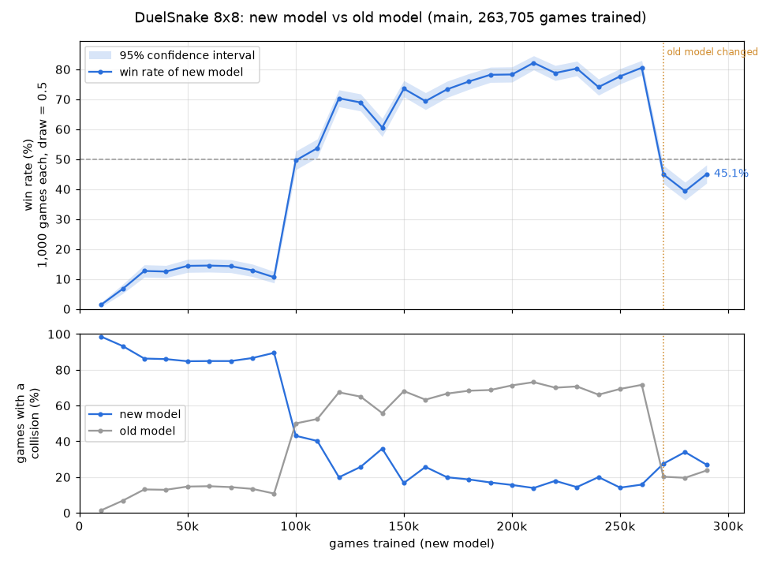

# モデル学習の見直しと学習の経過

DuelSnake-AI の AI (自己対戦の Double DQN) を強くするために、学習の設定をどう変えたか、変えた結果どれだけ強くなっているかをまとめたページです。
設定の本体は [learn/config.yaml](../../learn/config.yaml)、ゲームのルールは [learn/RULES.md](../../learn/RULES.md) にあります。

## 学習の経過

学習中、1 万試合ごとにモデルを保存した直後に、そのモデル (新モデル) を旧モデルと 1,000 試合対戦させ、勝率を記録しています。
旧モデルは main ブランチにある同じ盤面サイズのモデルで、見直す前の設定で学習したものです。グラフが 50% を上回っていれば、新モデルのほうが強いことを表します。

### 8x8

ほかの盤面サイズも、学習すると同じ形のグラフ `winrate-<幅>x<高さ>.png` がこのフォルダにできます (10x10 なら `winrate-10x10.png`)。

### グラフの読み方

- **上段**: 新モデルの勝率 (引き分けは 0.5 勝) と、その 95% 信頼区間 (帯)。破線が 50%。
- **下段**: 1,000 試合のうち、それぞれのモデルが壁・自分の体・お邪魔ブロックに衝突した試合の割合。見直しの狙いは、新モデルのこの割合を下げることです。
- **横軸**: 新モデルがそれまでに学習した試合数。
- **縦の点線**: 学習の途中で main のモデルが更新され、比べる相手 (旧モデル) が変わったところ。

### 測り方

- どちらのモデルもランダムな行動はせず、いつも Q 値が最大の行動を取ります。
- 同じ盤面で先手と後手を入れ替えて 2 試合ずつ行い、盤面の運とプレイヤー番号による偏りを打ち消します。
- 毎回同じ乱数シードの盤面で対戦させるので、点ごとの違いは盤面の違いではなくモデルの違いです。
- 1,000 試合の勝率の 95% 信頼区間は、およそ ±3% です。1 点だけの上下より、続けて見たときの傾向を見てください。

## 何を変えたか

### 見直す前の問題

8x8 盤面で旧設定のモデルを調べると、次のことが分かりました。

1. **決着のほとんどが衝突だった。** 旧モデルどうしの対戦では、決着の約 95% がどちらかの衝突でした。8x8 (64 マス) の盤面で長さ 34 ほどまで伸び、自分の体に囲まれて衝突していました。
2. **報酬が勝敗よりリンゴ集めに偏っていた。** リンゴ 1 個で 4、金のリンゴで 10 の報酬に対し、勝ち負けは ±50 でした。1 試合で 100 以上稼げるので、勝つことより伸びることを優先していました。
   ルール上、相手より長く生き残れば勝ちで、スコアは時間切れのときにしか効きません ([RULES.md の 9 章](../../learn/RULES.md))。
3. **学習中の試合が、本番の試合と違っていた。** 学習中は 5% (ε = 0.05) の確率でランダムに動くため、1 試合に 5 回ほどランダムな行動が入り、試合は平均 85 ティックで終わっていました。
   ランダムな行動が無ければ試合は平均 199 ティック続くので、実際に負けが決まる「体が長くなった終盤」をほとんど学習できていませんでした。
4. **ネットワークが 16x16 盤面向けのままだった。** 畳み込みで 2 回縮めるため、8x8 では 2x2 まで小さくなり、頭の周りのどのマスが空いているかが失われやすくなっていました。
5. **リプレイが短かった。** 毎秒数千の経験が入るのに容量が 20 万件しかなく、直近の 30 秒ほどの経験しか残っていませんでした。

### 変更点

| 項目 | 前 | 後 | 理由 |
|---|---|---|---|
| リンゴの報酬 | 4 | 1 | スコアの増減と同じ大きさにし、勝ち負け (±50) を優先させる (問題 2) |
| 金のリンゴの報酬 | 10 | 3 | 同上 |
| 毒リンゴの報酬 | −10 | −1 | スコアは減るが、体が短くなって生き残りやすくなる面もあるので、重い罰にしない |
| ブロック消去・お邪魔を取る報酬 | 3 | 1 | 上に合わせて小さくする |
| ランダムに動く確率 (ε) の最終値 | 0.05 | 0.01 | 学習中の試合が終盤まで続くようにする (問題 3) |
| ε を下げきるまでの判断回数 | 100 万 | 200 万 | 序盤の探索を少し長くする |
| 学習率 | 0.0005 | 0.00025 | ネットワークを大きくしたので、学習を安定させる |
| リプレイの容量 (8x8) | 20 万件 | 40 万件 | 古い経験も残し、同じ場面ばかり学習しないようにする (問題 5) |
| 学習を始めるまでに貯める経験 | 1 万件 | 2 万件 | 最初の更新が偏らないようにする |
| ネットワーク | 全盤面で共通 | 盤面サイズごと (下の表) | 盤面の大きさに合わせる (問題 4) |

勝ち負けの報酬 (±50)、割引率 (0.99)、リンゴへの引力などの補助の報酬は変えていません。

### 盤面サイズごとのネットワーク

ネットワークは「盤面 → 3x3 の畳み込み 3 層 → 全結合 256 → 6 つの行動の Q 値」の形です。表の `32/1` は「32 チャネル、ストライド 1 (縮めない)」を表します。

| 盤面 | 畳み込み | 畳み込みの出力 | パラメータ数 | 1 回の推論の積和 | リプレイの容量 |
|---|---|---|---|---|---|
| 前 (全盤面) | 16/1, 32/2, 64/2 | 8x8 なら 2x2 | 約 6 万 | 約 34 万 | 20 万件 |
| 8x8 | 32/1, 32/1, 64/2 | 4x4 | 約 30 万 | 約 147 万 | 40 万件 (約 950MB) |
| 10x10 | 32/1, 32/1, 64/2 | 5x5 | 約 45 万 | 約 229 万 | 25 万件 (約 900MB) |
| 12x12 | 32/1, 32/2, 64/1 | 6x6 | 約 63 万 | 約 230 万 | 20 万件 (約 1.0GB) |
| 16x16 | 32/1, 32/2, 64/2 | 4x4 | 約 30 万 | 約 241 万 | 11 万件 (約 980MB) |

- 衝突を避けるには頭の周りの細かい位置が要るので、なるべく元の解像度のまま畳み込む層を残しています。
- 学習は GPU を使わず CPU で行うので、広い盤面ほど早めに縮め、10x10 以上では 1 回の推論の計算量をそろえています。
- リプレイは、どの盤面でもメモリが 1GB 弱に収まる件数にしています。

ネットワークを大きくしたので、1 秒あたりの更新回数は 8x8 で前の約 2.3 分の 1 になりました。
これらの設定は [learn/config.yaml](../../learn/config.yaml) の `model`・`board_sizes`・`reward`・`train` にあります。

## 変えた効果 (8x8 での試し)

見直した設定で 8x8 のモデルを新しく学習し、2,000 試合ずつ対戦させた結果です。

| 新しい設定のモデル | 相手 | 新しい設定のモデルの勝率 |
|---|---|---|
| 18.1 万回更新 | 旧設定で 18.6 万回更新したモデル (学習量をそろえた比較) | **66.4% ± 2.1%** |
| 23.3 万回更新 | 旧設定で 66.8 万回更新したモデル | **72.6% ± 2.0%** |
| 23.3 万回更新 (12.5 万試合) | main のモデル (旧設定で 240 万試合) | **62.2% ± 2.1%** |

- 新しい設定のモデルは、衝突した試合の割合が約 60% から 26〜31% に下がりました。旧モデルより体を少し短めに保ち (長さ 27〜29、旧モデルは 31〜34)、相手が先に衝突して勝つ試合が増えています。
- 学習中の試合も平均 85 ティックから約 166 ティックに延び、終盤を学習できるようになりました。

この試しは学習を始めてから約 2 時間 20 分の時点のものです。上のグラフは、これより長く学習したときの推移を記録したものです。
10x10・12x12・16x16 の設定はまだ学習して確かめていません。

## 記録の仕組み

| ファイル | git | 内容 |
|---|---|---|
| `docs/training/winrate-<幅>x<高さ>.csv` | 管理しない | 評価 1 回ごとに 1 行。試合数・更新回数・勝ち負け・勝率と信頼区間・平均スコア・衝突した割合・旧モデルの情報 |
| `docs/training/winrate-<幅>x<高さ>.png` | 管理する | CSV から描いたグラフ (このページに載せているもの) |
| `docs/training/archive/` | 管理しない | 新しく学習を始めたときに移した、前の学習の CSV |

- `just train` で新しく学習を始めると、前の CSV を `archive/` に移し、0 試合から記録し直します。
- `just train-resume` で再開すると、再開した時点より後の行を消してから、続きを足していきます。
- グラフは `python3` と matplotlib で描きます ([learn/scripts/plot_winrate.py](../../learn/scripts/plot_winrate.py))。描けなくても学習は止まらず、ログに警告が出ます。CSV から描き直すときは `just winrate-plot` を実行します。
- 自動コミット (通算 10 万試合ごと) では、モデルと一緒にこのグラフもコミットしてプッシュします。
- 対戦の試合数は `learn/config.yaml` の `train.eval_games` (既定 1,000、0 なら対戦しない)、間隔は `train.save_interval_games` (既定 1 万試合) で変えられます。
  1,000 試合の対戦は 8x8 で 10 秒ほどです。
